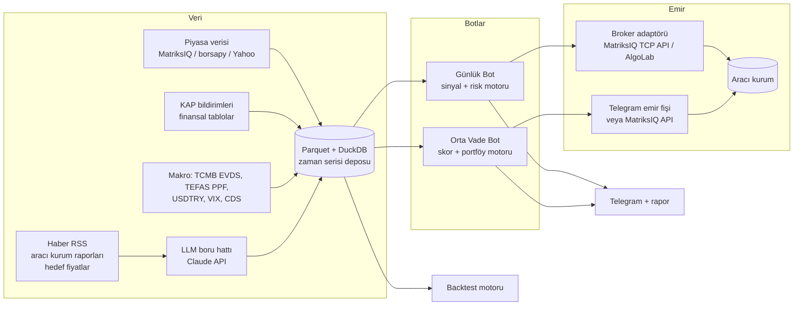

# 00 · Genel bakış ve mimari

## 1. Hedefler

| Hedef | Ölçüt |
|---|---|
| Kârlılık | Maliyet ve vergi sonrası getiri hem **XU100 toplam getirisini** hem **para piyasası fonu (PPF)** getirisini geçmeli |
| Risk kontrolü | Günlük bot için azami düşüş ≤ %15, orta vade için ≤ %25 (backtest + paper) |
| Tekrarlanabilirlik | Her karar loglanır. Aynı veriyle aynı karar yeniden üretilebilir |
| Açık kaynak | Kimlik bilgisi, kişisel veri ve lisanslı ham veri repoya girmez |

## 2. Üst düzey mimari



## 3. Bileşenler

| Katman | Sorumluluk | Teknoloji önerisi |
|---|---|---|
| `data/` | Ham verinin indirilmesi, düzeltilmesi (bedelsiz/temettü), point-in-time saklanması | Python, `borsapy`, `yfinance`, `httpx`; Parquet + DuckDB |
| `features/` | İndikatör ve faktörler (ATR, VWAP, RVOL, z-skorlar, F-Score…) | `polars` / `pandas`, `numba` |
| `nlp/` | KAP/haber/rapor sınıflandırma, duygu skoru, bilanço dipnot okuma | Claude API: küçük model filtre, büyük model analiz. Prompt caching + Batch API |
| `strategies/daily/` | ORB-SIP, VWAP geri çekilme, rejim filtresi | Saf Python, olay tabanlı |
| `strategies/midterm/` | Skor, kademeli giriş/çıkış, varlık dağılımı | Saf Python |
| `risk/` | Pozisyon boyutu, limitler, kill-switch | Ortak modül |
| `execution/` | Broker adaptörleri: `PaperBroker`, `MatriksIQBroker`, `AlgoLabBroker`, `IBKRBroker`, `ManualTicketBroker` | Soyut `Broker` arayüzü |
| `backtest/` | Olay tabanlı motor, maliyet/kayma modeli, walk-forward, raporlama | Aynı strateji kodu backtest ve canlıda çalışır |
| `ops/` | Zamanlayıcı, izleme, Telegram, loglar | `APScheduler`, `python-telegram-bot`, yapılandırılmış JSON log |

**Kural:** Strateji kodu broker'ı bilmez, sadece `Broker` arayüzüyle konuşur. Böylece backtest, paper ve canlı modlarında **aynı kod** çalışır.

## 4. Çalışma ortamı

| Bot | Ortam | Neden |
|---|---|---|
| Günlük Bot | **Windows VPS (İstanbul)** + MatriksIQ + Python bot aynı makinede | MatriksIQ Windows masaüstü uygulaması. API'si yerel TCP portu (18890) üzerinden dinliyor |
| Orta Vade Bot | Linux sunucu / ev bilgisayarı + cron | Düşük frekans. Yürütme manuel olabilir |
| Backtest | Herhangi bir makine | Veriler Parquet olarak taşınabilir |

Alternatif yol: Günlük botu doğrudan **MatriksIQ Algo (C#)** içinde yazmak. Avantajı stop/emir yönetiminin platform içinde kalması ve .NET bilgisinin doğrudan kullanılabilmesi. Dezavantajı açık kaynak paylaşımı ve backtestin platforma bağlı kalması. **Öneri:** Araştırma ve backtest Python'da. Canlıda iki seçenek de karşılaştırılacak (bkz. [06](06-yol-haritasi-ve-riskler.md)).

## 5. Zaman çizelgesi (Türkiye saati, UTC+3)

| Saat | Günlük Bot | Orta Vade Bot |
|---|---|---|
| 07:30 | Gece haberleri, KAP, ABD kapanışı, vadeli endeksler, VBTS listesi | KAP/haber taraması → çıkış uyarıları |
| 09:40–09:55 | Açılış seansı emir toplama: teorik açılış fiyatı ve gap izlenir | – |
| 10:00 | Sürekli işlem başlar. Açılış aralığı oluşur | – |
| 10:05 / 10:15 | Hisse seçimi + giriş emirleri | – |
| 10:05–16:00 | Girişler. 16:00'dan sonra yeni giriş yok | – |
| 17:25 | Bekleyen giriş emirleri iptal | – |
| **17:30–17:55** | **Tüm pozisyonlar kapatılır** | – |
| 18:00–18:10 | (Kullanılmaz) | BIST kapanış seansı: orta vade emirleri kapanış fiyatından |
| 18:15 | Gün sonu raporu | – |
| Cuma 19:00 | – | Haftalık skor + gelecek haftanın emir planı |
| 16:30 / 17:30 | ABD açılışı (yaz / kış) | ABD emirleri (limit) |

> Not: Kışın (Kasım–Mart) ABD piyasası 17:30'da açılıyor. Bu, günlük botun kapanış penceresiyle çakışıyor ve o dakikalarda volatilite artabiliyor (bkz. [03](03-gunluk-bot.md) §8).

## 6. Depo yapısı (hedef)

```
bist-trading-bots/
├── config/            # YAML parametre dosyaları (sırlar .env'de)
├── data/              # (gitignore) ham ve işlenmiş veri
├── docs/              # bu plan
├── src/
│   ├── data/ features/ nlp/ risk/ execution/ backtest/ ops/
│   └── strategies/{daily,midterm}/
├── notebooks/         # keşif analizleri
└── tests/
```

## 7. Güvenlik ve açık kaynak kuralları

- API anahtarları, kurum şifreleri ve Telegram token'ları **yalnızca `.env`** içinde durur ve `.gitignore` ile dışarıda kalır.
- Lisanslı ham veri (Matriks, BIST) repoya konmaz. Sadece indirme scriptleri paylaşılır.
- Botların ürettiği sinyaller kamuya "al/sat önerisi" olarak yayımlanmaz. Bu, SPK lisansı gerektiren yatırım danışmanlığı kapsamına girebilir.
