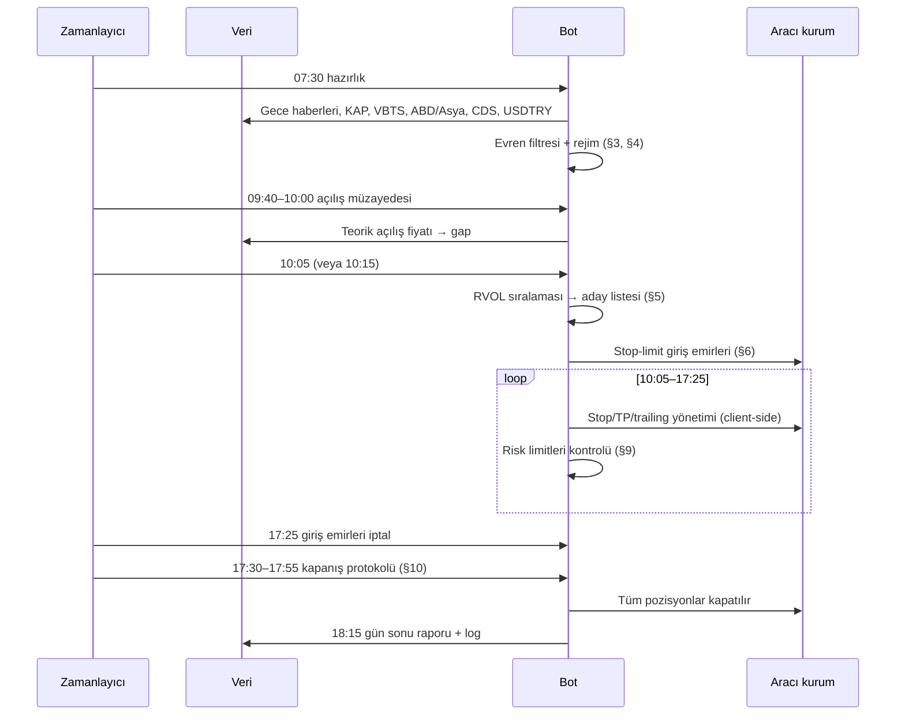

# 03 · Günlük Bot: tam spesifikasyon

## 0. Kullanıcı kuralları (değişmez)

| # | Kural |
|---|---|
| K1 | Evren: **BIST100** hisseleri |
| K2 | Sabah açılışı incelenir, o gün işlem yapılacak hisseler seçilir |
| K3 | Gün içinde kullanılan toplam pozisyon değeri **≤ özkaynağın %80'i** |
| K4 | Her işlemin stop-loss ve take-profit seviyesini bot kendisi belirler |
| K5 | Kapanmamış tüm pozisyonlar **17:30–17:55** arasında kapatılır. Bot geceye pozisyon taşımaz |

## 1. Neden bu yöntem?

| Kanıt | Bulgu | Bizim için anlamı |
|---|---|---|
| Zarattini, Barbon, Aziz (2024), *A Profitable Day Trading Strategy for the U.S. Equity Market* | 5 dakikalık açılış aralığı kırılımı (ORB), sadece **"stocks in play"** hisselerde (göreceli hacmi en yüksek 20 hisse, RVOL ≥ 1): 2016–2023 arasında net **%1.637**, Sharpe **2,81**, max DD %12. **Filtre olmadan aynı ORB: Sharpe 0,48** | Edge kırılımın kendisinden değil, **hangi hissede** yapıldığından geliyor. Seçim en kritik adım |
| Aynı çalışma, aralık uzunluğu | 5 dk: Sharpe 2,81 · 15 dk: 1,43 · 30 dk: 0,21 · 60 dk: 0,40 | Kısa aralık daha iyi. Ancak BIST'te 09:40–10:00 açılış müzayedesi olduğu için 5 ve 15 dk birlikte test edilecek |
| Gao, Han, Li, Zhou (2018), *Market Intraday Momentum*, JFE | Günün **ilk yarım saat** getirisi ve **sondan ikinci yarım saat** getirisi, **son yarım saat** getirisini tahmin ediyor (R² ≈ %2, volatil günlerde daha güçlü) | 17:30–17:55 kapanış penceresinde "kârlı pozisyonu biraz daha tut" kuralının dayanağı |
| Bizim maliyet analizi ([01](01-maliyetler-ve-vergiler.md)) | BIST'te gidiş-dönüş maliyet %0,10–0,34 | ABD'deki 0,10×ATR stop kullanılamaz. **Stop ≥ ~6,7 × maliyet** olmalı |

> ABD sonuçları BIST'e doğrudan taşınamaz: 100 hisselik dar bir evren, açılış müzayedesi, fiyat adımları ve açığa satış kısıtları var. Bu yüzden her parametre backtest ızgarasında yeniden kalibre edilecek (§13).

## 2. Günlük akış

## 3. Evren filtresi (her sabah, önceki kapanışa kadarki veriyle)

| Filtre | Varsayılan | Gerekçe |
|---|---|---|
| Endeks üyeliği | O günün BIST100 listesi | K1 |
| VBTS tedbiri | **Brüt takas, tek fiyat ve emir paketi tedbiri olanlar hariç** | Brüt takasta aynı gün alınan hisse satılamaz, bu da K5'i ihlal eder |
| Fiyat adımı / fiyat | ≤ **%0,08** | Örtük maliyet (bkz. [01](01-maliyetler-ve-vergiler.md) §1.2) |
| 20 günlük ortalama TL hacim | ≥ **300 milyon TL** | Likidite ve kayma |
| ATR(14) / fiyat | **%2,0 – %7,0** | Çok düşükse hareket maliyeti karşılamaz, çok yüksekse stoplar savrulur |
| Hak kullanım günü | Temettü/bedelsiz/bedelli ex-günü hariç | Gap ve RVOL bozulur |
| İşlem durdurma | Gün içinde durdurulan veya durdurulma bildirimi olan hisseler hariç | Kapanış riski |

## 4. Piyasa rejimi filtresi

| Seviye | Koşul | Mod |
|---|---|---|
| **Normal** | XU100 kapanış > EMA(20) ve EMA(20) eğimi > 0 | En fazla 4 pozisyon, RVOL eşiği θ |
| **Temkinli** | XU100 < EMA(20) **veya** VIX > 25 **veya** S&P vadeli açılış öncesi < −%1 | En fazla 2 pozisyon, RVOL eşiği 1,5·θ, risk/işlem yarıya |
| **Kapalı** | Türkiye 5Y CDS günlük artış > +25 bp **veya** XU100 teorik açılış gap'i < −%3 **veya** piyasa geneli devre kesici | O gün yeni giriş yok |

**Olay pencereleri (yeni giriş yasak):**

| Olay | Pencere |
|---|---|
| TCMB PPK kararı (14:00) | 13:45–14:30 |
| ABD CPI / istihdam / FOMC verisi | Açıklama ±10 dk (yaz 15:30, kış 16:30) |
| TÜİK enflasyon verisi (10:00) | O gün açılış aralığı **10:15–10:30** olarak alınır |
| Yarım gün (arefe) | Kapanış penceresi seans sonuna göre kayar (§10) |

**Gün içi filtre:** Long girişte XU100 (veya VİOP XU030 vadeli) kendi VWAP'ının üzerinde olmalı. Altındaysa hissenin endekse göre gün içi göreceli gücü > +%1,5 şartı aranır.

## 5. Hisse seçimi: "Stocks in Play" skoru

Göreceli hacim (açılış aralığı uzunluğu $m$ = 5 veya 15 dk):

$$
RVOL_{i,t} = \frac{V_{i,t}^{[10{:}00,\;10{:}00+m)}}{\dfrac{1}{14}\displaystyle\sum_{k=1}^{14} V_{i,t-k}^{[10{:}00,\;10{:}00+m)}}
$$

Açılış gap'i ve ATR'ye göre normalize edilmiş gap:

$$
g_{i,t} = \frac{O_{i,t}}{C_{i,t-1}} - 1, \qquad \tilde g_{i,t} = \frac{g_{i,t}}{ATR\%_{i,t-1}}
$$

Seçim skoru:

$$
S_{i,t} = \ln RVOL_{i,t} \;+\; \beta_1\,\mathbb{1}[\text{KAP/haber olayı}]_{i,t} \;+\; \beta_2 \min\!\left(\max(\tilde g_{i,t}, 0),\, 1\right)
$$

Varsayılanlar: $\beta_1 = 0.3$, $\beta_2 = 0.2$. Bu ağırlıklar backtestte $\{0, 0.3, 0.6\}$ ızgarasıyla denenecek.

**Seçim kuralı:**

1. $RVOL \ge \theta$ olanlar alınır. Varsayılan $\theta = 2.0$, test edilecek değerler: 1,5 / 2 / 3.
2. Açılış aralığı mumu **yükselişte** olmalı: $C^{OR} > O^{OR}$. Doji ise işlem yok.
3. Fiyat VWAP'ın üzerinde olmalı.
4. Aşırı gap koruması: $g > +2 \cdot ATR\%$ ise ve KAP/haber olayı yoksa elenir.
5. $S$'ye göre sıralanır, ilk $n_{max}$ (normal mod 4) aday seçilir.

## 6. Strateji A: ORB-SIP (birincil)

| Öğe | Kural |
|---|---|
| Giriş | **Stop-limit alış**: tetik = $OR_{high}$ + 1 adım, limit = tetik + 2 adım (kaymayı sınırlar) |
| Geçerlilik | 12:00'ye kadar tetiklenmezse iptal (test: 11:00 / 12:00 / 14:00) |
| İlk stop | Aşağıdaki stop formülü |
| TP1 | Giriş + **2R** seviyesinde pozisyonun **%50**'si satılır. Stop, başabaş + maliyet seviyesine çekilir |
| Kalan pozisyon | 5 dk barlarda chandelier trailing veya VWAP kırılımı. Hangisi önce gelirse |
| Zaman çıkışı | §10 kapanış protokolü |
| Yeniden giriş | Aynı hissede günde en fazla 2 giriş. Stop sonrası 30 dk bekleme |

**Stop mesafesi:**

$$
d_i = \max\!\left(k_{atr}\cdot ATR\%_{i},\; d_{min}\right), \qquad d_{min} = \max\!\left(6.7\,c_{rt},\; 4\cdot\frac{\text{adım}}{P}\right)
$$

$$
\text{stop}_i = P_{giriş}\,(1 - d_i), \qquad d_i > d_{max} = \%2.0 \;\Rightarrow\; \text{işlem yapılmaz}
$$

Varsayılan $k_{atr} = 0.35$. Test edilecek değerler: 0,25 / 0,35 / 0,50, ayrıca yapısal stop $OR_{low}$ − 1 adım.

**Trailing stop (TP1 sonrası):**

$$
TS_t = \max\!\left(TS_{t-1},\; HH_t - m_{ts}\cdot ATR^{5dk}_{14},\; \text{başabaş}\right), \qquad m_{ts} = 2.0
$$

Ayrıca 5 dk bar, VWAP'ın altında kapanırsa kalan pozisyon kapatılır.

**Karşılaştırmalı varyant (backtestte):** Orijinal çalışmadaki gibi TP yok, sadece stop + gün sonu çıkışı. Hangisi daha iyiyse o seçilir.

## 7. Strateji B: VWAP geri çekilme (ikincil, 11:00–16:00)

ORB tetiklenmeyen veya kaçırılan güçlü hisseler için:

| Koşul | Değer |
|---|---|
| Trend | Son 60 dk boyunca fiyat > VWAP. Hissenin XU100'e göre gün içi getirisi > +%1 |
| Geri çekilme | Fiyat VWAP'a veya EMA(20, 5 dk)'ya değer. Geri çekilme mumlarında hacim, 20 bar ortalamasının altında |
| Tetik | Önceki 5 dk mumun tepesini aşan yükseliş kapanışı → limit alış |
| Stop | Geri çekilme dibi − 1 adım (en az $d_{min}$) |
| TP / trailing | ORB ile aynı (2R'de %50 + trailing) |
| Öncelik | Sadece ORB'den boş kalan kapasiteyle |

## 8. Pozisyon boyutu ve %80 kuralı

Özkaynak $E$, işlem başı risk $r$, hisse başına risk $D_i = P_{giriş} - \text{stop}_i$:

$$
Q_i = \left\lfloor \min\!\left( \frac{r\,E}{D_i},\; \frac{G_{max}\,E}{n_{max}\,P_i},\; \frac{\lambda\, ADV^{TL}_{i}}{P_i} \right) \right\rfloor
$$

$$
\text{Kısıt (K3):}\quad \sum_{i \in \text{açık}} Q_i\,P_i \;\le\; 0.80\,E
$$

| Parametre | Varsayılan | Not |
|---|---|---|
| $r$ (işlem başı risk) | %0,5 | Temkinli modda %0,25 |
| $G_{max}$ | 0,80 | K3 |
| $n_{max}$ | 4 | Pozisyon başına en fazla %20 |
| $\lambda$ (likidite payı) | %0,5 | 20 günlük ortalama TL hacmin binde 5'i |

Örnek: $E$ = 500.000 TL, ATR %3,5, $k_{atr}$ = 0,35 olsun. Stop %1,23 olur, risk bazlı nominal ~204.000 TL çıkar, ama %20 tavanı 100.000 TL'de bağlar. Efektif risk ≈ %0,25 olur. Yani pratikte **%80 tavanı ve pozisyon sayısı** belirleyici.

## 9. Risk limitleri ve kill-switch

| Limit | Eşik | Aksiyon |
|---|---|---|
| Günlük zarar | −%1,5 $E$ | Tüm pozisyonlar kapatılır, gün biter |
| Günlük kâr kilidi | +%2,5 $E$ | Tüm trailing stoplar 1×ATR(5dk)'ya sıkılaştırılır, yeni giriş yok |
| Haftalık zarar | −%4 $E$ | Gelecek hafta risk/işlem yarıya iner |
| Aylık zarar | −%8 $E$ | Bot durur. Manuel inceleme ve paper moda dönüş |
| Art arda zararlı gün | 5 | 2 gün paper mod |
| Veri gecikmesi | Fiyat akışı > 10 sn bayat | Yeni giriş yok. > 60 sn ise pozisyonlar kapatılır |
| Emir reddi | Günde > 3 | Bot durur, Telegram alarmı |
| Pozisyon uyuşmazlığı | Kurum ≠ bot defteri | Pozisyonlar kapatılır, bot durur |
| Watchdog | Bot süreci düşerse | Ayrı süreç 17:35'te kurum tarafındaki tüm pozisyonları kapatır |

## 10. Kapanış protokolü (K5): 17:30–17:55

Pencere seans sonuna göre tanımlanır: başlangıç = seans sonu − 30 dk, son tarih = seans sonu − 5 dk. Normal günlerde bu tam olarak 17:30–17:55'tir, yarım günlerde otomatik kayar.

| Saat | Adım |
|---|---|
| 17:25 | Bekleyen tüm giriş emirleri iptal |
| 17:30 | **Zayıf pozisyonlar** (zararda veya fiyat < VWAP) marketable limit ile kapatılır (alış fiyatı −1 adım). Emir, son 1 dk hacminin %10'unu aşıyorsa dilimlenir |
| 17:30–17:50 | **Güçlü pozisyonlar** tutulabilir. Koşullar: kârda + fiyat > VWAP + XU100'ün ilk yarım saat getirisi $r_1 > 0$ + 17:00–17:30 getirisi $r_{15} > 0$ (gün içi momentum, Gao vd. 2018). Trailing 1×ATR(5dk)'ya sıkılaşır |
| 17:50 | Kalan her şey marketable limit ile kapatılır |
| 17:53 | Dolmayanlar agresif fiyattan (alış −2 adım) veya piyasa emri (KİE) ile kapatılır |
| 17:55 | Pozisyon kontrolü. Açık kalan varsa alarm + piyasa emri. Taban kilidi gibi kapatılamayan durum loglanır (geceye taşıma riski) |

**Kış saati notu:** Kasım–Mart arasında ABD piyasası 17:30'da açılıyor. 17:25–17:40 arasında spread ve volatilite artabilir. `us_open_guard: true` ise bu pencerede güçlü pozisyonların trailing'i 1×ATR'ye sıkılaştırılır.

## 11. Emir yönetimi

- **Stoplar istemci tarafında:** BIST'te borsa düzeyinde stop emri yok. Bot stopları kendisi izler ve tetiklenince marketable limit gönderir. Yedek olarak kurum/platform şartlı emri kullanılır (⚠ Midas+Matriks desteği teyit edilecek).
- **OTR ve iptal ücretleri:** Emir değiştirme en fazla **dakikada 1**. Trailing güncellemeleri 5 dk bar kapanışında yapılır. Hedef: emir/işlem oranı < 3.
- **Fiyat yuvarlama:** Tüm fiyatlar fiyat adımı tablosuna göre yuvarlanır (alışta yukarı, satışta aşağı).
- **Kısmi dolum:** Giriş kısmi dolarsa kalan miktar tetik + 2 adım limitine kadar bekler, 5 dk sonra iptal edilir.
- **Idempotency:** Her emre `client_order_id` verilir. Yeniden bağlanmada çift emir oluşmaz.

## 12. Özel durumlar

| Durum | Davranış |
|---|---|
| Hisse bazlı devre kesici | Pozisyon varsa bekler. Kapanış penceresine sarkarsa açılır açılmaz kapatılır. Gün içinde > %7 hareket etmiş hisseye yeni giriş yok |
| Tavan/taban yakınlığı | Fiyat, günlük limite %3'ten yakınsa yeni giriş yok |
| Endeks değişim günü / vade sonu | Normal. Kapanış seansındaki dengesizlik bizi etkilemez (17:55'te düzüz) |
| KAP'ta gün içi önemli bildirim | Pozisyon varsa: olumsuz bildirimde (skor ≤ −1) hemen çıkış |
| Bağlantı kopması | Watchdog (§9) |

## 13. Backtest parametre ızgarası

| Parametre | Değerler |
|---|---|
| Açılış aralığı $m$ | 5, 15 dk |
| RVOL eşiği $\theta$ | 1,5 · 2,0 · 3,0 |
| $n_{max}$ | 2, 3, 4 |
| $k_{atr}$ (stop) | 0,25 · 0,35 · 0,50 · yapısal ($OR_{low}$) |
| TP modu | 2R%50 + trailing · sadece trailing · gün sonu (orijinal) |
| Giriş son saati | 11:00 · 12:00 · 14:00 |
| Rejim filtresi | açık / kapalı |
| Kapanışta momentum tutma | açık / kapalı |
| Strateji B | açık / kapalı |

Toplam kombinasyon sayısı ~5.200. Fazla optimizasyonu (overfitting) önlemek için walk-forward + Deflated Sharpe kullanılır (bkz. [05](05-backtest-plani.md)). **Parametre seçimi tek bir en iyi noktaya göre değil, komşu bölgelerin de iyi olduğu "plato"ya göre** yapılır.

## 14. Faz 2: açığa satış (opsiyonel)

- Ön şart: Açığa satışa izin veren kurum ve hesap (Midas'ta ⚠ teyit). Hisse VBTS'de açığa satış yasağında olmamalı.
- Simetrik kural: Düşüşteki açılış mumu + $OR_{low}$ kırılımı + fiyat < VWAP + XU100 < VWAP.
- Fiyat kısıtları: Açığa satış emirleri SPK/BIST fiyat kurallarına tabi (son fiyatın altına emir kısıtı vb.). Backtestte bu kısıt uygulanır.
- Kredi/ödünç maliyeti maliyet modeline eklenir.

## 15. Loglama ve rapor

- Her karar için zaman damgası, girdiler (RVOL, gap, rejim), çıktı ve gerekçe → `decisions` tablosu.
- Her emir/dolum → `orders`, `fills`.
- 18:15 Telegram raporu: gün P&L (TL ve R), işlem listesi, maliyet dökümü, emir/işlem oranı, limit ihlalleri.
- Haftalık: kazanma oranı, ortalama R, profit factor, maliyet/brüt kâr oranı, kayma (beklenen vs gerçekleşen).

## Kaynaklar

- [Zarattini, Barbon, Aziz – A Profitable Day Trading Strategy for the U.S. Equity Market (özet)](https://concretumgroup.com/a-profitable-day-trading-strategy-for-the-u-s-equity-market/) · [tam metin](https://www.alexandria.unisg.ch/server/api/core/bitstreams/3c2989c4-688d-4d78-8a71-f02690990d51/content)
- [Gao, Han, Li, Zhou – Market Intraday Momentum (Alpha Architect özeti)](https://alphaarchitect.com/attention-prop-traders-the-first-half-hour-of-trading-predicts-the-last-half-hour/)
- [Garanti BBVA – BIST işlem saatleri](https://www.garantibbva.com.tr/borsa-hisse-senetleri/bist-islem-saatleri)
- [Borsa İstanbul – Fiyat marjları ve adımları](https://borsaistanbul.com/en/price-bands)
- [Borsa İstanbul – Pay piyasası prosedürü](https://borsaistanbul.com/files/pay-piyasasi-proseduru.pdf)
- [QNB Invest – VBTS nedir](https://www.qnbinvest.com.tr/investodak/qnbarastirma/volatilite-bazli-tedbir-sistemi-vbts-nedir)
