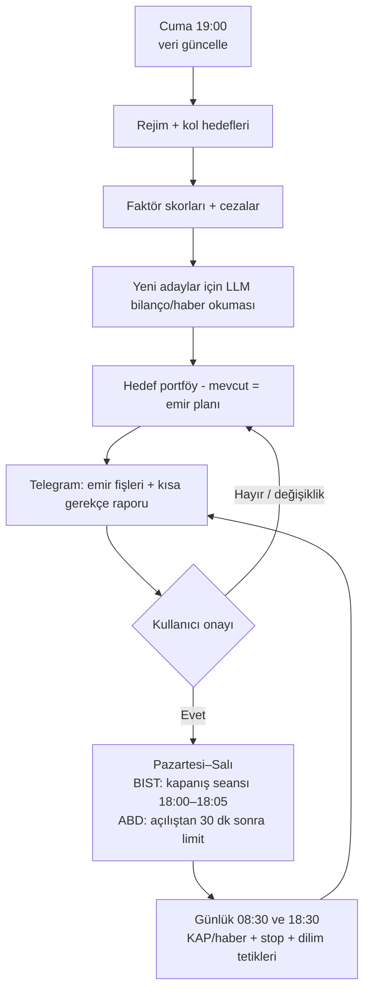

# 04 · Orta Vade Bot: tam spesifikasyon

## 0. Kullanıcı kuralları

| # | Kural |
|---|---|
| O1 | Elde tutma süresi tipik olarak **1–16 hafta**, gerekirse daha uzun |
| O2 | **Kademeli** ve **ucuzken** alım |
| O3 | Bilanço okuma, uzman analizleri ve haber takibi karar sürecinin parçası |
| O4 | Yurt dışı hisseler portföye girebilir |
| O5 | Kripto **≤ %10** |
| O6 | Maliyetler Midas komisyonlarıyla hesaplanır |

## 1. Kanıt tabanı

| Etki | Kaynak | Kullanım |
|---|---|---|
| Momentum (12-1 ay) | Jegadeesh & Titman (1993). BIST'te de anlamlı (Özyeğin Üni., *Mispricing in Borsa Istanbul stock returns*, 2018) | Skor bileşeni |
| Brüt kârlılık / ROA | Novy-Marx (2013). BIST'te de anlamlı (aynı tez) | Kalite bileşeni |
| Sermaye ihracı (net hisse ihracı) | BIST'te anlamlı (aynı tez): ihraç yapan şirketler geride kalıyor | **Bedelli sermaye artırımı cezası** |
| Varlık büyümesi, tahakkuklar | BIST'te ABD'nin **tersi** yönde çıkmış (aynı tez) | Bu iki faktör **kullanılmaz** |
| Piotroski F-Score | Piotroski (2000) | Kalite filtresi |
| Bilanço sonrası sürüklenme (PEAD) | Bernard & Thomas (1989) | Bilanço sürprizi bileşeni |
| Trend takibi / zaman serisi momentumu | Moskowitz, Ooi, Pedersen (2012). Faber (2007) 200 günlük ortalama | Varlık sınıfı dağılımı ve kripto kolu |
| LLM ile haber duygu skoru | Lopez-Lira & Tang (2023): LLM skorları günlük getiriyi örneklem dışında tahmin ediyor, küçük hisselerde ve kötü haberde daha güçlü | Haber bileşeni + olay bazlı çıkış |

## 2. Portföy yapısı (kollar)

| Kol | Bant | Varsayılan hedef | Araç |
|---|---|---|---|
| **BIST hisse** | %20 – %80 | Rejime göre (§3) | Midas uygulaması (komisyon %0) |
| **Yurt dışı hisse/ETF** | %10 – %40 | %20 | Midas ABD (1,5 $) / AB (1,5 €). Büyük tutarda UCITS ETF |
| **Kripto** | %0 – **%10 (sert tavan)** | Trende göre 0 / %4 / %7 | Midas Kripto (%0,15) |
| **Nakit** | %0 – %60 | Kalan | TL: PPF. USD: Midas dolar nema |
| (Opsiyonel) Altın | %0 – %10 | %0 | Altın fonu / sertifika. Kullanıcı onayıyla açılır |

## 3. Varlık dağılımı rejim modeli (haftalık)

**BIST rejim skoru** $R_{BIST} \in \{0,1,2,3,4\}$:

$$
R_{BIST} = \mathbb{1}\!\left[XU100^{TL} > SMA_{200}\right] + \mathbb{1}\!\left[XU100^{USD} > SMA_{200}\right] + \mathbb{1}\!\left[\text{Genişlik}_{50} > \%50\right] + \mathbb{1}\!\left[\text{TCMB son karar} \le 0\right]
$$

- Genişlik$_{50}$: BIST100 hisselerinden 50 günlük ortalamasının üzerinde olanların oranı.
- TCMB son karar ≤ 0: son PPK kararı indirim ya da sabit.

| $R_{BIST}$ | 0 | 1 | 2 | 3 | 4 |
|---|---|---|---|---|---|
| BIST hedef ağırlık | %20 | %35 | %50 | %65 | %75 |

**Göreceli cazibe düzeltmesi:** XU100'ün ileriye dönük kazanç getirisi (E/P) PPF net getirisinin altındaysa BIST hedefi 10 puan düşürülür:

$$
\frac{E}{P}_{XU100} < r^{net}_{PPF} \;\Rightarrow\; w_{BIST} \leftarrow w_{BIST} - 0.10
$$

**Yurt dışı:** S&P 500 > SMA$_{200}$ ise %25, değilse %10. USD/TRY'nin 3 aylık değişimi TL faiz farkını aşıyorsa +5 puan (kur koruması).

**Kripto:** §11.

**Kademeli geçiş:** Hedef değişiklikleri tek seferde değil, **3 haftaya yayılarak** uygulanır (her hafta 1/3). XU100 geçiş sırasında %5'ten fazla düşerse kalan dilimler hemen alınır ("ucuzken hızlan").

## 4. BIST hisse seçimi

### 4.1 Evren

- BIST100 + BIST TÜM içinde 20 günlük ortalama TL hacmi ≥ 50 milyon TL olanlar.
- Hariç tutulanlar: VBTS tedbirliler, fiili dolaşım < %15, son 12 ayda SPK işlem yasağı/manipülasyon soruşturması olanlar.

### 4.2 Faktörler

Her faktör sektör içinde standartlaştırılır ve ±3'te kırpılır:

$$
z_{i,k} = \operatorname{clip}\!\left(\frac{x_{i,k} - \mu_{s(i),k}}{\sigma_{s(i),k}},\; -3,\; 3\right)
$$

| Bileşen | Ağırlık $w_k$ | Ölçütler (eşit ağırlıklı alt skor) |
|---|---|---|
| **Değer** | %20 | Kazanç getirisi (FAVÖK/FD), FD/Satış (ters), PD/DD (ters), serbest nakit akışı getirisi. Bankalarda ROE'ye göre düzeltilmiş PD/DD |
| **Kalite** | %25 | Brüt kâr/aktif, ROE, Piotroski F-Score, Net borç/FAVÖK (ters), Faaliyet nakit akışı/FAVÖK, net döviz pozisyonu/özkaynak |
| **Momentum** | %25 | 12-1 ay getiri, 6-1 ay getiri, XU100'e göre göreceli güç, 52 hafta zirvesine yakınlık |
| **Bilanço sürprizi** | %15 | SUE (aşağıda), FAVÖK marjı değişimi, son bilanço sonrası 3 günlük anormal getiri |
| **Analist** | %10 | Güvenilirlik ağırlıklı konsensüs potansiyeli, son 30 gündeki revizyon yönü |
| **Haber/KAP** | %5 | 30 günlük LLM olay skoru ortalaması (üstel azalan) |

Kompozit skor:

$$
S_i = \sum_k w_k\, z_{i,k} \;-\; \text{Ceza}_i
$$

> Analist ve haber bileşenlerinin geçmiş verisi point-in-time elde edilemiyor ve LLM look-ahead sorunu var. Bu yüzden backtest **ilk 4 bileşenle** yapılır. Son 2 bileşen paper trading'de ölçülür (bkz. [05](05-backtest-plani.md)).

### 4.3 Bilanço sürprizi (TMS 29 uyumlu)

TMS 29'da önceki dönem rakamları cari alım gücüne göre yeniden düzenlendiği için mevsimsel karşılaştırma aynı rapor içinde yapılır:

$$
SUE_{i,q} = \frac{X_{i,q} - X^{\text{düz.}}_{i,q-4}}{\sigma\!\left(X_{i,q-j} - X^{\text{düz.}}_{i,q-j-4}\right)_{j=1..8}}
$$

Burada $X$ = FAVÖK (net kâr değil, çünkü net parasal pozisyon kalemleri oynaklık yaratır). Skor, KAP yayın zamanından **sonraki ilk seansta** kullanılmaya başlanır ve 60 işlem günü boyunca etkili kalır.

### 4.4 Türkiye'ye özgü cezalar (Ceza$_i$)

| Kırmızı bayrak | Ceza |
|---|---|
| Son 6 ay içinde bedelli sermaye artırımı kararı / yüksek ihraç | −0,5 |
| Net döviz açık pozisyonu > özkaynağın %30'u | −0,5 |
| Net kârda "net parasal pozisyon kazancı" payı > %50 | −0,3 |
| Şartlı veya olumsuz denetim görüşü | **Elenir** |
| İlişkili taraf alacakları > özkaynağın %20'si | −0,3 |
| Ana ortağın son 3 ayda net satışı | −0,3 |
| Son 6 ayda 2'den fazla VBTS tedbiri | −0,3 |

### 4.5 LLM ile bilanço okuma (her yeni bilanço için)

Girdi: KAP finansal rapor + faaliyet raporu + dipnotlar. Çıktı JSON şeması:

```json
{
  "ticker": "XXXXX",
  "period": "2026Q3",
  "revenue_real_growth_yoy": 0.07,
  "ebitda_margin_change_bps": 150,
  "net_fx_position_try": -1.2e9,
  "one_offs": ["arsa satış kârı 340m TL"],
  "guidance": "2027 kapasite artışı %20",
  "red_flags": ["ilişkili taraf alacağı arttı"],
  "quality_score": 0.62,
  "summary_tr": "…",
  "confidence": 0.8
}
```

- Sayısal alanlar mutlaka `borsapy`/İş Yatırım verisiyle **çapraz kontrol** edilir. Uyuşmazlık > %5 ise LLM çıktısı kullanılmaz.
- LLM'in rolü sayıları hesaplamak değil, **niteliksel bayrakları** (tek seferlik kalemler, rehberlik, riskler) çıkarmaktır.

## 5. Uzman ve analist katmanı

1. **Toplama:** Hedef fiyat/öneri (hedeffiyat.com.tr, `borsapy`), aracı kurum bülten PDF'leri, opsiyonel YouTube/podcast transkriptleri.
2. **Yapılandırma (LLM):** `{kaynak, tarih, hisse, öneri, hedef fiyat, vade, gerekçe}`.
3. **Kaynak güvenilirliği:** Her kaynağın geçmiş önerileri, öneri tarihinden sonraki 3 aylık XU100'e göre fazla getiri ($\alpha$) ile puanlanır. Az örnekli kaynaklar sıfıra doğru büzülür:

$$
\omega_s = \frac{n_s}{n_s + n_0}\cdot \max\!\left(0,\; \frac{\bar\alpha_s}{\sigma_{\alpha,s}}\right), \qquad n_0 = 20
$$

4. **Hisse analist skoru:** $u_{i,s}$ = kaynağın hedef fiyatına göre potansiyel. Bunun üstüne son 30 gündeki net yukarı revizyon sayısı $\Delta_i$ eklenir:

$$
A_i = \frac{\sum_s \omega_s\, u_{i,s}}{\sum_s \omega_s} \;+\; \gamma\, \frac{\Delta_i}{N_i}, \qquad \gamma = 0.1
$$

**İlke:** Uzmanı dinlemek, uzmanı **ölçmek** demektir. İsabet geçmişi ölçülmemiş görüşler sıfır ağırlık alır.

## 6. Haber ve KAP olay katmanı

| Olay türü | Yön | Aksiyon |
|---|---|---|
| Pay geri alım programı / içeriden alım | + | Skora +; bekleyen dilim (T2) tetiklenebilir |
| Gelirin > %5'i büyüklüğünde yeni sözleşme/iş ilişkisi | + | Skora + |
| Bedelsiz sermaye artırımı kararı | +/belirsiz | Sadece momentum bayrağı. Tek başına alım sebebi değil |
| Kredi notu / hedef fiyat artışı | + | Analist katmanı |
| Bedelli sermaye artırımı | − | Ceza (§4.4) |
| Ana ortak satışı / blok satış | − | Ceza. Pozisyon varsa trailing sıkılaşır |
| Kâr uyarısı, üretim durması, büyük dava | −− | **Tez kırılması** → 1–2 seans içinde çıkış |
| SPK yaptırımı, manipülasyon soruşturması, işlem yasağı | −−− | **Anında çıkış** + 12 ay kara liste |

Olay skoru üstel olarak azalır (yarı ömür 10 işlem günü):

$$
N_{i,t} = \sum_{e \in \mathcal{E}_i} \text{yön}_e\cdot \text{önem}_e \cdot 2^{-(t - t_e)/10}
$$

## 7. "Ucuz" tanımı ve adil değer

**Temel ucuzluk.** Adil değer, sektör çarpanı ile analist konsensüsünün harmanıdır:

$$
FV_i = 0.6\cdot FV^{\text{çarpan}}_i + 0.4\cdot FV^{\text{konsensüs}}_i, \qquad U_i = \frac{FV_i}{P_i} - 1
$$

$FV^{\text{çarpan}}$: Sektör medyan FD/FAVÖK × şirket FAVÖK − net borç. Bankalarda ROE–PD/DD regresyonu kullanılır.

**Teknik ucuzluk (yükselen trendde geri çekilme).** Hisse $P > SMA_{200}$ iken aşağıdakilerden biri gerçekleşirse:

$$
P \le SMA_{50} - 1\cdot ATR_{20} \quad \text{veya} \quad RSI_{14} \le 35
$$

Uzun vadeli momentum içinde kısa vadeli geri çekilmeden alım yapmak, "düşen bıçağı tutmayı" önler. $P < SMA_{200}$ ise geri çekilme alımı **yapılmaz**.

## 8. Giriş: kademeli alım (3 dilim)

Aday koşulu: Skor sıralamasında **ilk %20** + rejim izin veriyor + $U_i > \%15$.

| Dilim | Pay | Tetik | Geçerlilik |
|---|---|---|---|
| **T1** | %40 | Aday olduğu haftanın ilk kapanış seansı. Aşırı uzama yoksa: $RSI_{14} < 70$ ve $P < 1.15\cdot SMA_{50}$ | Koşul sağlanana kadar haftalık yeniden değerlendirme |
| **T2** ("ucuzken") | %30 | Teknik ucuzluk koşulu (§7) **veya** T1 fiyatından −1×ATR$_{20}$. Ön şart: skor hâlâ ilk %30'da ve olumsuz olay yok | T1'den sonra 6 hafta |
| **T3** (teyit) | %30 | T2 sonrası fiyat 20 günlük ortalamanın üzerinde kapanış yapar **veya** yeni bilanço SUE > 0 **veya** T1'den 4 hafta sonra skor ilk %20'de | T1'den sonra 10 hafta |

- Dilim açılmazsa o dilimin parası nakit (PPF) kolunda kalır.
- **Ortalama düşürme sınırı:** T2 yalnızca bir kez açılır. Ortalama maliyetin −%15 altına düşen pozisyona ek alım yapılmaz.

## 9. Çıkış kuralları (öncelik sırasıyla)

| # | Tür | Kural | Uygulama |
|---|---|---|---|
| 1 | Tez kırılması | §6'daki −− / −−− olaylar, şartlı denetim görüşü | 1–2 seans (−−− ise hemen) |
| 2 | Felaket stopu | Ortalama maliyetten −%15 | Ertesi seans |
| 3 | Trailing (haftalık kapanış) | $P_{haftalık} < \max\!\left(\bar P - 2.5\,ATR_{20},\; P_{zirve} - 3\,ATR_{20}\right)$ | Ertesi seans |
| 4 | Skor bozulması (histerezis) | Skor sıralaması **ilk %50'nin dışına** düşer. Alım eşiği %20, satım eşiği %50 olduğu için gereksiz devir azalır | 1–2 haftaya yayılarak |
| 5 | Değerleme | $P \ge FV$ → %50 kâr al. $P \ge 1.15\,FV$ → tamamı (momentum ilk %10'da ise trailing ile devam) | Kapanış seansı |
| 6 | Zaman incelemesi | 16. haftada: elde tutma getirisi < aynı dönemin PPF getirisi **ve** skor ilk %30'da değil → çık. Değilse devam (O1: zorunlu üst süre yok) | Haftalık |
| 7 | Rejim | Kol hedefi düşerse en düşük skorlu pozisyonlardan başlanarak azaltılır | 3 haftaya yayılarak |

## 10. Pozisyon boyutu ve limitler

Kol ağırlığı $W_{kol}$ içinde, skor eğimli ters volatilite ağırlıklandırması:

$$
w_i = \min\!\left( w_{max},\; W_{kol}\cdot\frac{S_i^{+}/\sigma_i}{\sum_j S_j^{+}/\sigma_j} \right)
$$

| Limit | Değer |
|---|---|
| Tek BIST hissesi | ≤ %10 |
| Tek yurt dışı hisse | ≤ %7 |
| Tek geniş ETF | ≤ %20 |
| Sektör (BIST) | ≤ %25 |
| BIST pozisyon sayısı | 8–15 |
| Yurt dışı tekil hisse sayısı | ≤ 8 |
| Kripto toplamı | ≤ %10 (aşarsa %8'e indirilir) |
| Portföy azami düşüşü | −%20'de BIST + yurt dışı kolları yarıya inilir. −%25'te nakit + manuel inceleme |

## 11. Kripto kolu (≤ %10)

| Öğe | Kural |
|---|---|
| Varlıklar | BTC (%70), ETH (%30) |
| Trend | $P > SMA_{200}$ **ve** $SMA_{50} > SMA_{200}$ → %7. Sadece biri sağlanıyorsa %4. Hiçbiri yoksa %0 |
| Rebalans | Hedeften ±2 puan sapınca. Haftalık kontrol |
| Sert tavan | Fiyat artışıyla %10'u aşarsa %8'e indirilir |
| Vergi kaydı | Her işlemin TL maliyet bazı (FIFO) kaydedilir. Mevzuat belirsiz (bkz. [01](01-maliyetler-ve-vergiler.md) §4) |

## 12. Yurt dışı kolu

| Öğe | Kural |
|---|---|
| Çekirdek (kolun ≥ %60'ı) | Geniş endeks ETF'leri (S&P 500, Nasdaq-100, MSCI World). Tutar büyüdükçe UCITS versiyonları (veraset vergisi riski) |
| Uydu (≤ %40) | Tekil ABD hisseleri. Aynı faktör modeli; veri SEC EDGAR + fiyat. Bilanço sürprizi ve analist revizyonu ABD'de daha güvenilir veriyle çalışır |
| Minimum pozisyon | 1.500 $ |
| Vergi engeli | Beklenen TL getirisi şu eşiği geçmeli: $E[r^{TL}] \cdot (1 - \tau) > r_{PPF}^{net} \cdot h$ ($\tau$: tahmini marjinal vergi oranı, $h$: elde tutma süresi/yıl) |
| Kur | USD kolu kalıcı. TL↔USD dönüşümü sadece hedef 5 puandan fazla değişince yapılır |
| Zarar hasadı | Aralık ayında: yıl içi gerçekleşmiş yurt dışı kazanç varsa, zarardaki pozisyonlar satılıp benzer bir ETF ile değiştirilir |

## 13. Haftalık işleyiş



**Emir fişi formatı (Telegram):**

```
[AL • T1] XXXXX  |  BIST  |  Kapanış seansı
Adet: 1.250   Limit: 42,30 (kapanış ±%1)   Tutar: ~52.900 TL (%5,3)
Skor: 1,42 (ilk %8)  •  Potansiyel: %28  •  Rejim: 3/4
Gerekçe: FAVÖK SUE +2,1; momentum ilk %15; 3 kurum hedef yükseltti
Stop (haftalık kapanış): 36,90   •   T2 tetik: ≤ 40,10
```

## 14. Backtest parametre ızgarası

| Parametre | Değerler |
|---|---|
| Faktör ağırlıkları (değer/kalite/momentum/sürpriz) | eşit · varsayılan · momentum ağır · kalite ağır |
| Alım eşiği / satım eşiği (yüzdelik) | 20/50 · 10/40 · 30/60 |
| Dilim yapısı | 40/30/30 · 100 (tek seferde) · 33/33/33 (zaman bazlı DCA) |
| Trailing ATR çarpanı | 2,5 · 3 · 4 |
| Rejim modeli | açık · kapalı (sabit %60 BIST) |
| Rebalans sıklığı | haftalık · 2 haftalık · aylık |
| Kripto trend filtresi | açık · kapalı (sabit %5) |

## Kaynaklar

- [Özyeğin Üniversitesi – Mispricing in Borsa Istanbul stock returns](https://eresearch.ozyegin.edu.tr/handle/10679/6087)
- [Bilgi Üniversitesi – Testing the validity of factor investing strategies in Borsa Istanbul](https://openaccess.bilgi.edu.tr/items/c177758b-f4f9-4469-a8dc-838a2ad2787a/full)
- [Lopez-Lira & Tang – Can ChatGPT Forecast Stock Price Movements?](https://arxiv.org/abs/2304.07619)
- [Garanti BBVA – BIST işlem saatleri (kapanış seansı)](https://www.garantibbva.com.tr/borsa-hisse-senetleri/bist-islem-saatleri)
- [Midas – Ücretler](https://www.getmidas.com/ucretler/)
- [Yapı Kredi – Yabancı hisse senedi gelirlerinde 2026 vergi durumu](https://www.yapikredi.com.tr/medium/file/yabanci-hisse-senedi-gelirlerinde-2026-yili-vergi-durumu_71999/view)
